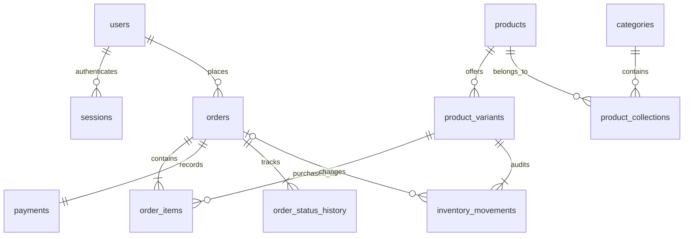

# PostgreSQL schema

Money is stored as integer centavos, never floating-point currency. UUIDs identify accounts, orders, and payment records. Existing product IDs 0–30 are preserved so older browser bags still refer to the same products. Each product and size variant has its own unique SKU.

| Table | Stores |
| --- | --- |
| schema_migrations | Applied migration version and time |
| users | Account UUID, normalized unique email, name, scrypt salt/hash, customer/admin role |
| sessions | Hashed session tokens, user foreign key, expiry |
| categories | Men, Women, Unisex, Accessories and Featured |
| products | Product ID/SKU, name, price, PHP currency, category/type, local image cell, colors, ordering, active flag |
| product_collections | Product-to-collection memberships |
| product_variants | Variant ID/SKU, product foreign key, size, available stock, low-stock threshold |
| orders | Order UUID/number, customer, shipping snapshot, amounts, status, tracking, request ID/hash, timestamps |
| order_items | Product/variant foreign keys and immutable name/SKU/size/quantity/price snapshots |
| payments | One simulated payment per order: amount, demo provider, approval/reversal, unique reference |
| order_status_history | Status transitions, actor, note and time |
| inventory_movements | Signed stock deltas, resulting quantity, reason, actor, optional order and time |

Foreign keys, unique email/SKU/size/request-ID constraints, nonnegative stock/amount checks and allowed status checks protect data. Checkout prices come from the database, not the browser. Row locks prevent overselling; per-customer locking and unique request IDs make repeated checkout safe. Changes to stock, orders and simulated payment records commit together. Cancellation takes an order lock before restoring stock and records an audit movement.

The SQL schema supports only the simulated payment provider in this version. Approved means the **demo payment** passed, not that money was collected. Production payment gateways and shipment integrations are outside this implementation.

Password recovery (migration 003) adds `password_reset_tokens` (hashed token, user, expiry, usage timestamp) and `password_reset_limits` (hashed request key, rolling window start, attempts). Order receipts are derived from stored orders/order items/payments; no duplicated receipt totals are stored.
